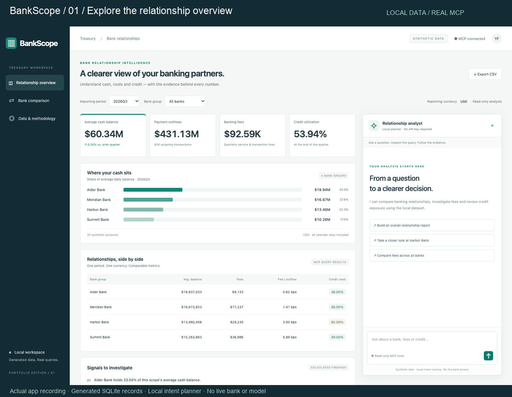
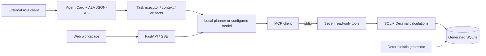

# BankScope — Bank Relationship Agent

**独立运行的银行关系分析工作台：自然语言查询、费用比较、授信分析，以及可追溯的数据报告。**

BankScope turns questions into read-only MCP queries and financial reports. It runs locally with generated SQLite data and public Python packages. **Default mode needs no company database, corporate account or model API key.**

**A2A + MCP:** other agents can now discover BankScope through an Agent Card, submit standard A2A tasks, receive streamed progress and retrieve structured results. The same analysis agent uses MCP to query the local database. [A2A integration guide](docs/A2A.md).



The demo recreates the reference video's **white conversation canvas, purple composer, grey report surface, numbered sections and financial tables** using the working local application. It follows a full report → Harbor Bank detail → fee investigation → cross-bank comparison, with typing and continuous scrolling. [Watch or download the clearer MP4](docs/media/bankscope-demo.mp4) · [Reproduce the recording](docs/DEMO.md).

Every answer uses actual MCP calls and generated SQLite records. Default mode uses explicit intent rules and calculated summaries; no live LLM runs in this recording. Reports appear section by section as a frontend presentation effect, not model token streaming. Frame timing is edited for readability.

## Run locally

Python **3.11+** required. First install needs internet; local analysis then works offline.

```bash
git clone https://github.com/yf2685-beep/bank-relationship-agent.git
cd bank-relationship-agent
./run.sh
```

Open **http://127.0.0.1:8000** for the conversation view. **Open workspace** leads to the dashboard at **http://127.0.0.1:8000/dashboard**. First startup generates the database. Stop with Ctrl+C.

Manual setup (use the appropriate virtual-environment activation command on Windows):

```bash
python3 -m venv .venv
source .venv/bin/activate
python -m pip install -r requirements.txt
python -m uvicorn bank_agent.web:app --host 127.0.0.1 --port 8000
```

## Explore

| Ask                                                               | Result                                                                                     |
| ----------------------------------------------------------------- | ------------------------------------------------------------------------------------------ |
| Show the overall bank relationship report for 2026Q3              | A multi-section report with account counts, balances, payments, fees, credit and positions |
| Show the relationship report for Harbor Bank                      | Bank-specific report, retaining the conversation's selected quarter                        |
| What about its fees?                                              | Fee query reusing the conversation's bank and quarter                                      |
| Compare fees for all banks in 2026Q3                              | Comparable fees and fee-to-outflow basis points                                            |
| Compare Alder and Harbor                                          | Side-by-side analysis for the same quarter and currency                                    |
| List dormant accounts                                             | Matching synthetic account registry                                                        |
| Show credit utilization / payment outflows / debt and investments | Corresponding read-only MCP tool                                                           |

The full report includes previous/current quarter tables, changes in cash, payments and fees, credit availability, and follow-up prompts. Expand **View analysis details** to inspect real tool names, arguments and timings. The prompt library, follow-up buttons and **New conversation** control work without an API key.

Use **••• → Export latest report as CSV** to download the most recent full relationship report, labeled with **SYNTHETIC**, period and currency columns. **Open workspace** provides charts, filters and its own chat panel; its state is separate from the conversation homepage. Within that dashboard, relationship-report replies update the displayed bank and quarter.

## Engineering capabilities

| Area                         | Implementation                                                                                  |
| ---------------------------- | ----------------------------------------------------------------------------------------------- |
| Agent-to-data integration    | MCP SDK discovers and calls seven tools over actual stdio transport                             |
| Agent-to-agent communication | A2A 0.3 JSON-RPC discovery, messages, streaming tasks, result retrieval and active cancellation |
| Financial modeling           | Accounts, daily balances, payment flows, fees, credit and debt/investment snapshots             |
| Numerical correctness        | Integer cents, Decimal averages, reconciled totals and explicit period/snapshot semantics       |
| Conversation context         | Intent routing and session-specific bank/quarter context                                        |
| Inspectable interaction      | SSE progress, tool parameters, result tables, calculation notes and CSV export                  |
| Model portability            | Optional OpenAI-compatible tool calling with a local model or your own provider                 |
| Bounded access               | Tool allowlist, parameterized SQL, read-only SQLite and bounded model rounds                    |



Dashboard, chat and export all retrieve reports through MCP. Database generation is a separate initialization step. The app binds to loopback by default for personal local use.

## Connect another agent with A2A

After starting the app, discover **http://127.0.0.1:8000/.well-known/agent-card.json**. Its JSON-RPC endpoint is **http://127.0.0.1:8000/a2a**. Try the official SDK client in another terminal:

```bash
.venv/bin/python examples/a2a_client.py --stream
```

The example sends a report request, receives task updates and artifacts, then asks a fee follow-up using the same contextId. Both requests execute actual local MCP queries. Standard message/send, message/stream, tasks/get and tasks/cancel are supported. Set BANK_AGENT_PUBLIC_URL if the advertised host or port changes. [Configuration, protocol examples and limitations](docs/A2A.md).

The GIF shows the web conversation path. The SDK example demonstrates the A2A path; both reuse the same analysis agent and MCP tools. A2A sessions and tasks are in memory, and this local service has no authentication or enterprise identity integration.

## Dataset and calculations

- Four fictional bank labels; **32 accounts**, four countries, four dormant accounts.
- **2025-01-01 to 2026-09-30**, seven complete quarters; default **2026Q3**.
- 20,416 daily balances, 7,056 payments, 588 fees, 28 credit snapshots and 56 position records.
- Fixed seed **2685**; labels, identifiers and amounts are generated without importing enterprise records.
- All amounts are **USD**. Country is an account attribute; no FX conversion is implied.

Average cash is the sum of per-account calendar-day averages. Payments are gross quarterly outflows. Credit and positions are quarter-end snapshots; debt and investments stay separate. Fee basis points use outgoing payment volume as the denominator. Report comparisons use the **previous quarter**, including the year boundary, and are unavailable for the first quarter in the dataset. Chat tables round amounts to whole USD; the API and CSV retain cents. [Schema and calculation contracts](docs/DATA.md).

The database at <code>data/treasury.sqlite</code> is excluded from Git. Regenerate with <code>python -m bank_agent.data --reset</code>, or set <code>BANK_AGENT_DB</code> to another local path.

## Optional model mode

Default <code>BANK_AGENT_MODE=local</code> supports the explicit banking intents above without an LLM. For broader phrasing, configure an OpenAI-compatible Chat Completions endpoint with tool-call support:

```bash
export BANK_AGENT_MODE=llm
export LLM_BASE_URL=http://127.0.0.1:11434/v1
export LLM_MODEL=your-installed-tool-capable-model
python -m uvicorn bank_agent.web:app --host 127.0.0.1 --port 8000
```

For a remote provider, use its HTTPS <code>/v1</code> base URL and export your own <code>LLM_API_KEY</code>. The provider receives your question and synthetic tool results. The app does not load company configuration or .env files. [.env.example](.env.example) lists supported settings; model installation and provider credits are not included.

Model mode uses the same tools with at most four model rounds and seven calls per round. Dashboard figures remain calculated; model-written prose can still be inaccurate. Inspect its tool results. Adapter tests use a simulated provider; no live paid model was used for the GIF.

## Test and inspect

```bash
python -m pip install -r requirements-dev.txt
python -m pytest -q
```

Tests cover reproducible generation, arithmetic, reconciliation, prior-quarter comparisons, snapshots, invalid inputs, read-only enforcement, session separation, seven tools over actual MCP, SSE, CSV and the model adapter. The recording script additionally checks browser interactions, exports, dashboard filters and mobile layout. [Full report](docs/media/report.png) · [Credit section](docs/media/credit.png) · [Fee analysis](docs/media/analysis.png) · [Dashboard](docs/media/workspace.png).

A2A tests additionally cover discovery, synchronous and streaming SDK clients, task retrieval, context isolation, failed-turn rollback, cancellation, invalid inputs and advertised URL validation.

| Source                                     | Purpose                                                 |
| ------------------------------------------ | ------------------------------------------------------- |
| [data.py](bank_agent/data.py)              | Schema and generator                                    |
| [analytics.py](bank_agent/analytics.py)    | Reporting scopes and calculations                       |
| [mcp_server.py](bank_agent/mcp_server.py)  | Independently usable MCP server                         |
| [agent.py](bank_agent/agent.py)            | MCP client, planner, context and model adapter          |
| [web.py](bank_agent/web.py)                | API, SSE and export                                     |
| [a2a.py](bank_agent/a2a.py)                | A2A Agent Card, executor, context and task lifecycle    |
| [a2a_client.py](examples/a2a_client.py)    | Official SDK discovery, streaming and follow-up example |
| [static/](bank_agent/static/)              | Responsive workspace; no frontend build step            |
| [capture_demo.py](scripts/capture_demo.py) | Repeatable recording                                    |

For another MCP client, first run <code>python -m bank_agent.data</code>, then launch <code>.venv/bin/python -m bank_agent.mcp_server</code> with this repository as working directory. Stdout is reserved for MCP.

## Portfolio scope

Created for Yuxuan Feng's portfolio as an independent bank-relationship analytics implementation. This public edition uses newly written code, generated data and public dependencies. Its conversation design and walkthrough are inspired by the reference demo; the interface is implemented in this repository and the recording is captured from that running app.

Company source history, internal SDKs, identity integrations, system URLs, business records and the original enterprise video are not included. This edition does not reproduce the enterprise deployment or execute transactions. Sessions are in memory and reset on restart; authentication and multi-user hosting are outside its scope.
