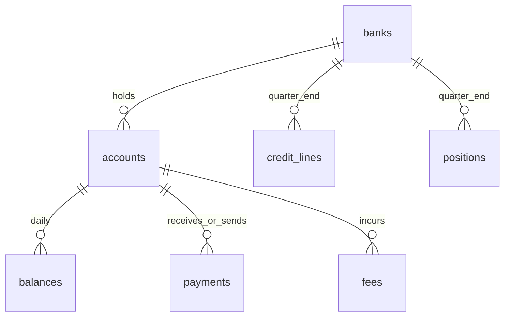

# Synthetic data and calculation contracts

Every record comes from <code>random.Random(2685)</code> and explicit formulas. No external dataset is read. This data exercises queries and UI behavior; it is not calibrated to real treasury distributions.

| Table        | Grain                                | Amounts                            |
| ------------ | ------------------------------------ | ---------------------------------- |
| banks        | Fictional bank                       | None                               |
| accounts     | DEMO account                         | Currency always USD                |
| balances     | Account × day                        | Nonnegative cents                  |
| payments     | Event and inflow/outflow direction   | Positive gross cents               |
| fees         | Active account × month               | Fee cents                          |
| credit_lines | Bank × quarter end                   | Limit and used cents; used ≤ limit |
| positions    | Bank × quarter end × debt/investment | Gross cents                        |
| metadata     | Generator property                   | Seed, coverage, provenance         |

All accounts exist throughout the dataset with complete daily balances. Four stay dormant, have zero balances and generate no payments or fees. Status is fixed; openings and closures are not simulated. Active accounts have six payment days per month in both directions; fees fall on the 28th.

## Contracts

1. Validate quarter and bank; unsupported values fail explicitly.
2. Calculate each account's daily average including zeros, then sum by bank. Complete coverage is guaranteed by this generator, not inferred from arbitrary imports.
3. Round bank averages to cents with Decimal ROUND_HALF_UP; sum those rounded values for the summary.
4. Sum outgoing quarterly payment flows. Inflows remain separate records.
5. Fee basis points = quarterly fees / gross outflows × 10,000. This analytical ratio is not a bank tariff.
6. Read credit and positions at the exact quarter end. Aggregate utilization = total used / total limit, not an unweighted average.
7. Keep debt and investments separate. Cash change compares with the previous quarter; the first quarter has no comparison.

All amounts are USD. API and CSV values are decimal strings; the UI uses compact labels and whole-dollar table cells. Export CSV for cents. The comparison tool retains each bank's share of the full four-bank portfolio and states that denominator in its evidence.

There are no missing days, absent snapshots, reversals, business calendars or FX tables. Adapting another source requires policies and tests for those cases. No enterprise import path is included.

Only the generator initializes the database. Runtime connections use SQLite <code>mode=ro</code> and <code>PRAGMA query_only=ON</code>. Tools accept validated filters, never SQL; table identifiers are constants. Back up a locally modified database before using <code>--reset</code>, which replaces it.
